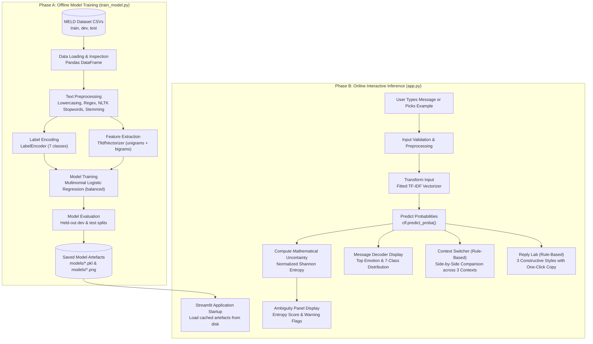

# Subtext AI — Beyond the Words
> **Tagline:** *Same words. Different meanings.*

An educational Natural Language Processing (NLP) project that explores emotion classification and situational subtext in short conversational text messages. Built using the Multimodal EmotionLines Dataset (MELD), TF-IDF n-gram feature extraction, Multinomial Logistic Regression, and an interactive Streamlit web interface styled with a clean red-and-white theme.

---

## Table of Contents

1. [Project Overview](#1-project-overview)
2. [Problem Statement](#2-problem-statement)
3. [Objectives](#3-objectives)
4. [Scope of the Project](#4-scope-of-the-project)
5. [Dataset Description](#5-dataset-description)
6. [Emotion Categories](#6-emotion-categories)
7. [Technology Stack](#7-technology-stack)
8. [System Architecture](#8-system-architecture)
9. [NLP Methodology: Preprocessing and TF-IDF](#9-nlp-methodology-preprocessing-and-tf-idf)
10. [Machine-Learning Model: Logistic Regression](#10-machine-learning-model-logistic-regression)
11. [Training and Evaluation Procedure](#11-training-and-evaluation-procedure)
12. [Evaluation Metrics and Empirical Results](#12-evaluation-metrics-and-empirical-results)
13. [Saved Model Artefacts](#13-saved-model-artefacts)
14. [Application Interface and Implemented Features](#14-application-interface-and-implemented-features)
15. [User Workflow](#15-user-workflow)
16. [Installation and Execution Instructions](#16-installation-and-execution-instructions)
17. [Project Folder Structure](#17-project-folder-structure)
18. [Project Limitations](#18-project-limitations)
19. [Future Enhancements](#19-future-enhancements)
20. [Conclusion](#20-conclusion)
21. [Report and PPT Preparation Guide for Teammates](#21-report-and-ppt-preparation-guide-for-teammates)
22. [Glossary of Technical Terms](#22-glossary-of-technical-terms)
23. [References and Acknowledgements](#23-references-and-acknowledgements)

---

## 1. Project Overview

### What is Subtext AI?
**Subtext AI** is an academic Natural Language Processing (NLP) application designed to study how short, everyday text messages are classified across seven discrete emotion categories and how their perceived meaning shifts when placed into different social contexts.

In digital communication (such as SMS, instant messaging, and workplace chat), messages are frequently brief, unpunctuated, and stripped of non-verbal cues. A phrase as simple as:

> **"Oh, great."**

can express completely divergent meanings depending on situational context:
* In a **friendly conversation**, it typically conveys genuine enthusiasm or celebration (*e.g., hearing that a friend passed an exam*).
* In a **disagreement or argument**, it frequently conveys biting sarcasm or exasperation (*e.g., discovering another unexpected complication*).
* In a **professional conversation**, it may signify formal acknowledgement or satisfaction with project progress.

However, the raw text itself—`"Oh, great."`—contains only two words. It contains no acoustic prosody (pitch, volume, inflection), no facial expressions, and no shared personal history. 

### Educational Purpose
Subtext AI was developed as an educational project to demonstrate the practical capabilities and fundamental boundaries of statistical text classification. Rather than acting as an opaque "black-box" that claims to read minds, the application:
1. Uses a trained machine-learning model (TF-IDF + Logistic Regression) to compute statistical class probabilities across seven emotion categories based on text patterns learned from dialogue corpora.
2. Quantifies predictive uncertainty using information theory (Normalized Shannon Entropy).
3. Demonstrates through side-by-side rule-based templates how the exact same words can be interpreted differently across personal, professional, and conflict scenarios without altering the classifier's statistical output.
4. Transparently displays its real evaluation metrics (35.98% test accuracy), providing an honest case study in NLP challenges.

> **Crucial Disclaimer:** Subtext AI is an educational demonstration tool. It does **not** claim to detect a person's actual internal emotional state, psychological sincerity, or hidden motives. Text alone cannot establish true human intent.

---

## 2. Problem Statement

### Academic Problem Statement
In short-text digital messaging, the literal lexical content of an utterance often diverges significantly from its pragmatic conversational intent. While modern machine-learning models can learn surface lexical correlations (such as associating the word *"great"* with positive sentiment), isolated text lacks the multimodal prosody, relational history, and situational context required for reliable human intent understanding. 

This project investigates the following primary research and engineering questions:
1. *How effectively can a classical statistical machine-learning pipeline (TF-IDF vectorization with Multinomial Logistic Regression) classify short conversational utterances into seven discrete emotion categories?*
2. *What are the quantitative and qualitative failure modes of text-only emotion classification when applied to imbalanced, open-domain dialogue data?*
3. *How can an interactive software system communicate model predictions, mathematical uncertainty, and contextual ambiguity transparently to users without fostering misplaced trust or overconfidence?*

### What This Implementation Solves and Does Not Solve
* **What it solves:**
  * Implements an end-to-end, reproducible NLP pipeline that ingests raw dialogue, normalises text through custom stemming and stopword filtering, extracts n-gram TF-IDF representations, and trains a multi-class linear classifier.
  * Provides an interactive graphical interface where users can test arbitrary text messages, view class probability distributions, examine mathematical entropy, inspect side-by-side contextual variations, and explore model evaluation visualisations.
* **What it cannot solve:**
  * It cannot detect sarcasm, deceit, passive-aggression, or genuine emotional truth.
  * It cannot infer conversational history or speaker identity because the classifier operates strictly on isolated, single-turn text inputs.
  * It cannot achieve high accuracy across minority classes due to the inherent noise and severe class imbalance of conversational dialogue.

---

## 3. Objectives

### Implemented Objectives (Complete)
* [x] **Data Ingestion and Exploration:** Ingest the 13,708 dialogue turns of the MELD dataset across official training, validation, and test splits.
* [x] **Text Preprocessing:** Build a normalisation pipeline incorporating lowercasing, URL removal, non-alphabetic filtering, stopword elimination, and Porter stemming.
* [x] **Numerical Feature Representation:** Map variable-length text to a 5,637-dimensional numerical feature space using unigram and bigram TF-IDF representations with sublinear term-frequency scaling.
* [x] **Model Training with Class Balancing:** Train a Multinomial Logistic Regression classifier with balanced class weights to mitigate majority-class dominance.
* [x] **Empirical Evaluation:** Evaluate the model on held-out validation and test sets; compute test accuracy, per-class precision, recall, F1-scores, and generate a 7×7 confusion matrix.
* [x] **Interactive Web Application:** Build a Streamlit application featuring:
  * **Message Decoder:** Real-time text preprocessing, inference, probability distribution display, and mathematical uncertainty calculation.
  * **Context Switcher:** A side-by-side comparative panel illustrating plausible interpretations across Personal, Professional, and Disagreement contexts.
  * **Reply Lab:** Selectable constructive response suggestions (Gentle, Direct, Neutral) with one-click clipboard copying.
  * **Emotion Lab:** A dedicated dashboard displaying saved test accuracy, confusion matrix heatmap, emotion distribution charts, and pipeline documentation.
* [x] **Scientific Transparency:** Explicitly separate model-driven statistical outputs from rule-based contextual templates, avoiding deceptive claims of "AI mind reading."

### Unimplemented / Future Objectives (Clearly Identified)
* [ ] **Multimodal Processing:** Incorporating acoustic audio signals or video facial landmarks from the raw MELD video clips (currently, only the text modality is utilized).
* [ ] **Multi-turn Contextual History:** Feeding previous conversation turns into an RNN, Transformer, or memory network (currently single-utterance only).
* [ ] **Deep Learning / Transformer Baselines:** Comparing Logistic Regression against fine-tuned BERT/RoBERTa models.

---

## 4. Scope of the Project

### Current Functional Scope
* **Target Audience:** Students, instructors, and researchers interested in natural language processing, text representation, machine-learning evaluation, and conversational ambiguity.
* **Input Space:** Single-turn English text messages entered manually or selected from curated test examples.
* **Output Space:** 
  * Predicted emotion label out of seven MELD classes (`anger`, `disgust`, `fear`, `joy`, `neutral`, `sadness`, `surprise`).
  * Softmax probability score for the top predicted class.
  * Full 7-class probability distribution bar chart.
  * Normalized Shannon Entropy score ($H_{\text{norm}} \in [0.0, 1.0]$) and runner-up margin ($p_1 - p_2$).
  * Side-by-side contextual interpretations across three situational settings.
  * Constructive response templates across three communication styles.
  * Complete evaluation metrics and visualisations in the Emotion Lab.

### Boundary Conditions & Limitations of Scope
* The classifier operates strictly on the vocabulary extracted during training. Words that do not appear in the training corpus or are pruned by frequency thresholds receive zero weight.
* The system is an educational prototype and is **not** production-ready for clinical psychological assessment, crisis intervention, legal intent analysis, or sentiment surveillance.

---

## 5. Dataset Description

Subtext AI is trained and evaluated on the **Multimodal EmotionLines Dataset (MELD)**, created by Poria et al. (2019). MELD is an expanded and enhanced version of the EmotionLines dataset, consisting of multi-party conversational dialogues extracted from the scripts of the television series *Friends*.

### Verified Dataset Files and Record Counts
All three official dataset splits reside in the [data/](file:///Users/adithirajkumar/Projects/subtext-ai/data) directory. The exact record counts and file properties were verified directly against the project CSV files:

| Dataset File | Role / Purpose | Exact Row Count | Number of Columns |
|---|---|---:|---:|
| [data/train_sent_emo.csv](file:///Users/adithirajkumar/Projects/subtext-ai/data/train_sent_emo.csv) | Model parameter training | **9,989** | 11 |
| [data/dev_sent_emo.csv](file:///Users/adithirajkumar/Projects/subtext-ai/data/dev_sent_emo.csv) | Validation / hyperparameter tuning | **1,109** | 11 |
| [data/test_sent_emo.csv](file:///Users/adithirajkumar/Projects/subtext-ai/data/test_sent_emo.csv) | Final unbiased test evaluation | **2,610** | 11 |
| **Total Corpus** | Across all three splits | **13,708** | 11 |

### Dataset Schema & Extracted Columns
Each CSV file contains 11 columns:
1. `Sr No.`: Serial row number.
2. `Utterance`: The raw text transcript of the spoken dialogue line (**Extracted as input feature $X$**).
3. `Speaker`: Character speaking the line (*e.g., Chandler, Joey, Monica, Phoebe, Rachel, Ross*).
4. `Emotion`: Discrete emotion category (**Extracted as target label $y$**).
5. `Sentiment`: Coarse three-class sentiment (*positive, neutral, negative*).
6. `Dialogue_ID`: Grouping index identifying the conversational scene.
7. `Utterance_ID`: Order of the utterance within the dialogue.
8. `Season`: TV series season number.
9. `Episode`: TV series episode number.
10. `StartTime`: Audio/video segment start timestamp.
11. `EndTime`: Audio/video segment end timestamp.

### Verified Emotion Distribution Across Splits

```
Split         Neutral    Joy   Surprise  Anger  Sadness  Disgust   Fear   Total
-------------------------------------------------------------------------------
Training        4,710  1,743      1,205  1,109      683      271    268   9,989
Validation        470    163        150    153      111       22     40   1,109
Testing         1,256    402        281    345      208       68     50   2,610
-------------------------------------------------------------------------------
Total Corpus    6,436  2,308      1,636  1,607    1,002      361    358  13,708
Percentage     47.0%  16.8%      11.9%  11.7%     7.3%     2.6%   2.6%  100.0%
```

> **Important Technical Note:** Although MELD was distributed with accompanying audio and video clips for multimodal benchmarking, **this project intentionally uses only the text modality (`Utterance` column)**. No audio features, spectrograms, or facial video embeddings are processed by the pipeline.

---

## 6. Emotion Categories

The target variable $y$ encompasses seven discrete emotion classes derived from Paul Ekman's universal emotion model, adapted for multi-party dialogue:

| Emotion | Operational Definition in Corpus | Illustrative Example (Not necessarily from dataset) |
|---|---|---|
| **Joy** | Expressions of happiness, celebration, amusement, affection, triumph, or relief. | *"I just found out I passed the final exam with honours!"* |
| **Neutral** | Factual, communicative, or logistical statements lacking marked emotional charge. | *"The team meeting is scheduled for tomorrow at two o'clock."* |
| **Surprise** | Expressions of astonishment, sudden startling news, or unanticipated developments. | *"I had no idea you were planning to visit today!"* |
| **Anger** | Expressions of irritation, resentment, hostility, grievance, or boundary enforcement. | *"I asked you three times not to touch my files, yet you did."* |
| **Sadness** | Low-energy expressions of sorrow, grief, disappointment, loneliness, or fatigue. | *"I tried my absolute best, but things didn't work out."* |
| **Disgust** | Expressions of physical revulsion, moral distaste, disapproval, or sensory aversion. | *"That food smells completely spoiled and rancid."* |
| **Fear** | Expressions of anxiety, worry, caution, apprehension, or dread regarding future risks. | *"I'm really worried that this mistake could get us into serious trouble."* |

> **Academic Note:** The classifier predicts which of these seven statistical buckets an utterance's vocabulary correlates with most strongly in the MELD training data. A prediction of `anger` means the utterance shares words or n-grams with sentences labeled as `anger` by annotators; it does not mean the user is clinically angry.

---

## 7. Technology Stack

The project relies on a verified, minimal Python data-science environment. The actual packages and their verified versions installed in the local environment are listed below:

| Technology / Library | Verified Version | Purpose in Project | How It Is Used |
|---|---|---|---|
| **Python** | `3.14.5` (or `3.10+`) | Core runtime environment | Executes data processing, model training, evaluation, and application serving. |
| **Pandas** | `3.1.0` | Dataframe manipulation | Loads CSV files, filters missing values, computes class distributions, and structures tabular reports. |
| **NumPy** | `2.x` | Numerical array computing | Computes array argmax, matrix manipulation, probability sorting, and entropy formulas. |
| **NLTK** | `3.10.4` | Natural language preprocessing | Supplies the English stopword corpus and the `PorterStemmer` algorithm. |
| **scikit-learn** | `1.9.1` | Machine learning algorithms | Provides `TfidfVectorizer`, `LogisticRegression`, `LabelEncoder`, and evaluation metric functions. |
| **Matplotlib** | `3.11.2` | Data visualisation | Renders the confusion matrix figure and class distribution bar charts. |
| **Seaborn** | `0.13.2` | Statistical visual plotting | Formats heatmaps and bar plots saved in the `models/` directory. |
| **Streamlit** | `1.66.1` | Interactive web application | Serves the web interface (`app.py`), session state, interactive forms, and metric widgets. |
| **Pickle (Standard Library)** | Built-in | Object serialisation | Serialises fitted vectorizer, classifier, label encoder, and evaluation dictionary into `.pkl` files. |
| **Joblib** | `1.6.0` | Dependency utility | Listed in `requirements.txt` as a fast model persistence alternative. |

---

## 8. System Architecture

The Subtext AI architecture cleanly decouples **Offline Model Training** from **Online Interactive Inference**.

### End-to-End Conceptual Workflow



### Architectural Separation
* **Statistical Inference Engine:** The mathematical output ($P(y|\mathbf{x})$) is computed exclusively by the trained TF-IDF vectorizer and Logistic Regression classifier.
* **Contextual & Reply Interpretation Layer:** The situational explanations (*Personal, Professional, Disagreement*) and response suggestions (*Gentle, Direct, Neutral*) are generated via **transparent, rule-based mapping dictionaries**. Selecting different contexts or reply styles does **not** alter the underlying classifier's probability distribution.

---

## 9. NLP Methodology: Preprocessing and TF-IDF

### Text Preprocessing Pipeline
Raw dialogue text is unstructured and contains typographical noise, punctuation variations, and irrelevant tokens. Both [train_model.py](file:///Users/adithirajkumar/Projects/subtext-ai/train_model.py) and [app.py](file:///Users/adithirajkumar/Projects/subtext-ai/app.py) use the **exact same deterministic preprocessing function**:

```python
def preprocess(text: str) -> str:
    if not isinstance(text, str):
        return ""
    text = text.lower()                                # 1. Lowercase
    text = re.sub(r"http\S+|www\S+", "", text)         # 2. Remove URLs
    text = re.sub(r"[^a-z\s]", "", text)               # 3. Strip punctuation & numbers
    tokens = text.split()                              # 4. Whitespace tokenisation
    tokens = [
        stemmer.stem(tok)                              # 5. Porter stemming
        for tok in tokens
        if tok not in STOP_WORDS and len(tok) > 1      # 6. Stopword & single-char filtering
    ]
    return " ".join(tokens)
```

1. **Lowercasing:** Ensures case-invariance (*e.g., "Great", "great", and "GREAT" map to the same token*).
2. **URL Removal:** Eliminates hyperlinks and domain patterns.
3. **Punctuation & Digit Stripping:** Retains only letters `a-z` and whitespace, removing exclamation marks, commas, and numeric digits.
4. **Tokenisation:** Splits the normalised string on whitespace.
5. **Stopword Filtering:** Removes 179 generic English grammatical words (*e.g., "the", "is", "at", "which"*) from NLTK's standard corpus that add noise without conveying emotion.
6. **Porter Stemming:** Reduces inflected or derived words to their linguistic base stems (*e.g., "helping", "helped", and "helpful" all reduce to "help"*).

### Numerical Representation: TF-IDF Vectorization
Machine learning algorithms cannot directly compute mathematical gradients on character strings; text must be projected into a numerical vector space $\mathbb{R}^D$.

**TF-IDF (Term Frequency – Inverse Document Frequency)** is computed as:

$$\text{TF-IDF}(t, d, D) = \text{TF}(t, d) \times \text{IDF}(t, D)$$

1. **Term Frequency ($\text{TF}$):** Measures how frequently token $t$ appears in a specific document $d$. The project uses **sublinear term frequency scaling** (`sublinear_tf=True`):
   $$\text{TF}_{\text{sublinear}}(t, d) = 1 + \log(\text{count}(t, d)) \quad \text{for } \text{count} > 0$$
   This prevents a token appearing 10 times in a sentence from exerting 10 times more influence than a token appearing once.
2. **Inverse Document Frequency ($\text{IDF}$):** Downweights tokens that appear ubiquitously across all dialogue lines:
   $$\text{IDF}(t, D) = \log\left(\frac{1 + |D|}{1 + \text{DF}(t, D)}\right) + 1$$
   Emotional keywords like *"furious"* or *"terrified"* appear in few sentences and receive high IDF weights, whereas common dialogue words receive low IDF weights.

### Verified Vectorizer Settings in Code
Inspecting line 187 of [train_model.py](file:///Users/adithirajkumar/Projects/subtext-ai/train_model.py):
* `ngram_range=(1, 2)`: Extracts both **unigrams** (single words, *e.g., "happy", "want"*) and **bigrams** (two-word sequences, *e.g., "not happy", "whatever want"*). Bigrams allow the model to capture simple negation and compound phrases.
* `max_features=20000`: Upper ceiling on vocabulary size.
* `min_df=2`: Prunes idiosyncratic tokens that appear in fewer than two training utterances, eliminating spelling typos.
* `sublinear_tf=True`: Applies logarithmic scaling to term frequency.
* **Resulting Vocabulary Size:** Exactly **5,637 distinct features** extracted from the training set.

---

## 10. Machine-Learning Model: Logistic Regression

### Why Logistic Regression?
While deep neural networks (such as BERT or LSTMs) are widely used in commercial NLP, **Multinomial Logistic Regression** was selected for this project because:
1. It provides a robust, mathematically sound, convex baseline that trains in seconds on commodity CPU hardware without requiring GPU compute.
2. It outputs well-calibrated class probabilities via the softmax function.
3. Its linear coefficients are fully interpretable, allowing direct inspection of which n-grams push predictions toward specific emotions.
4. It requires minimal memory footprint, ensuring seamless deployment inside a Streamlit web application.

### Mathematical Formulation
For an input TF-IDF vector $\mathbf{x} \in \mathbb{R}^{5637}$ and $K = 7$ emotion classes, the model computes a linear logit score for each class $k$:

$$z_k = \mathbf{w}_k^T \mathbf{x} + b_k$$

The logits are transformed into a normalized posterior probability distribution using the **Softmax function**:

$$P(y = k \mid \mathbf{x}) = \frac{e^{z_k}}{\sum_{j=1}^{7} e^{z_j}}$$

The predicted class is the index with the maximum probability:

$$\hat{y} = \arg\max_{k \in \{1, \dots, 7\}} P(y = k \mid \mathbf{x})$$

### Verified Hyperparameters in Code
Inspecting lines 219–225 of [train_model.py](file:///Users/adithirajkumar/Projects/subtext-ai/train_model.py):
* `max_iter=1000`: Ensures sufficient gradient-descent iterations for the solver to converge to global optimality.
* `C=1.0`: Inverse regularisation parameter ($L_2$ penalty) preventing weights from exploding on rare tokens.
* `class_weight="balanced"`: **Critical parameter.** In MELD, `neutral` has 4,710 training instances, while `fear` has only 268. Without class weighting, a classifier achieves ~47% accuracy simply by predicting `neutral` for every single utterance. The balanced setting automatically adjusts loss weights inversely proportional to class frequencies:
  $$w_k = \frac{N}{K \times N_k}$$
  This forces the model to heavily penalise misclassifications on minority emotions (`fear`, `disgust`, `sadness`).
* `solver="lbfgs"`: Limited-memory Broyden–Fletcher–Goldfarb–Shanno quasi-Newton optimization algorithm for multiclass problems.
* `random_state=42`: Ensures deterministic, reproducible training runs.

---

## 11. Training and Evaluation Procedure

### Data Splitting Strategy
The project follows standard machine-learning discipline by maintaining three separate, non-overlapping partitions:
1. **Training Set (`train_sent_emo.csv`, 9,989 rows):** Used exclusively to fit the `TfidfVectorizer` vocabulary and learn the Logistic Regression weight vectors $\mathbf{w}_k$.
2. **Development / Validation Set (`dev_sent_emo.csv`, 1,109 rows):** Used during model development to verify convergence, monitor overfitting, and evaluate generalization on unseen data.
3. **Test Set (`test_sent_emo.csv`, 2,610 rows):** Completely held out during feature extraction and training. Evaluated exactly once to compute final benchmark metrics.

### Step-by-Step Training Execution
When [train_model.py](file:///Users/adithirajkumar/Projects/subtext-ai/train_model.py) is executed:
1. Downloads required NLTK resources (`stopwords`, `punkt`, `punkt_tab`).
2. Loads all three CSV files into Pandas DataFrames and verifies zero invalid rows.
3. Applies `preprocess()` to every utterance in the training, development, and test sets.
4. Fits a `LabelEncoder` on the training labels (`['anger', 'disgust', 'fear', 'joy', 'neutral', 'sadness', 'surprise']`).
5. Fits the `TfidfVectorizer` on the cleaned training text, constructing the 5,637-feature vocabulary, and transforms the dev and test text.
6. Trains the `LogisticRegression` model on `(X_train, y_train)` using balanced class weighting.
7. Evaluates the model on the dev set, yielding a validation accuracy of **34.54%**.
8. Evaluates the model on the test set, yielding a test accuracy of **35.98%**.
9. Computes precision, recall, F1-score, support, and the 7×7 confusion matrix.
10. Generates and saves visual plots to `models/confusion_matrix.png` and `models/emotion_distribution.png`.
11. Serialises all artifacts to disk using Python's `pickle` module.

---

## 12. Evaluation Metrics and Empirical Results

### Metric Definitions for Beginners
* **Accuracy:** The overall proportion of test utterances correctly classified:
  $$\text{Accuracy} = \frac{\text{Correct Predictions}}{\text{Total Predictions}} = \frac{939}{2610} \approx 35.98\%$$
* **Precision:** When the model predicts emotion $X$, how often is it actually $X$?
  $$\text{Precision} = \frac{\text{True Positives}}{\text{True Positives} + \text{False Positives}}$$
* **Recall:** Of all actual instances of emotion $X$ in the test set, what percentage did the model successfully find?
  $$\text{Recall} = \frac{\text{True Positives}}{\text{True Positives} + \text{False Negatives}}$$
* **F1-Score:** The harmonic mean of precision and recall, balancing false alarms against missed detections:
  $$\text{F1} = 2 \times \frac{\text{Precision} \times \text{Recall}}{\text{Precision} + \text{Recall}}$$
* **Support:** The actual number of ground-truth test occurrences for that class.

### Verified Empirical Results on Test Set (2,610 Utterances)
The following metrics are loaded directly from [models/evaluation_results.pkl](file:///Users/adithirajkumar/Projects/subtext-ai/models/evaluation_results.pkl):

| Emotion Category | Precision | Recall | F1-Score | Support (Actual Test Samples) |
|---|---:|---:|---:|---:|
| **Anger** | 24.52% | 25.80% | 25.14% | 345 |
| **Disgust** | 8.62% | 22.06% | 12.40% | 68 |
| **Fear** | 4.46% | 18.00% | 7.14% | 50 |
| **Joy** | 36.36% | 40.80% | 38.45% | 402 |
| **Neutral** | 61.87% | 36.94% | 46.26% | 1,256 |
| **Sadness** | 21.78% | 31.73% | 25.83% | 208 |
| **Surprise** | 35.97% | 46.98% | 40.74% | 281 |
| **Overall Accuracy** | — | — | **35.98%** | **2,610** |
| **Macro Average** | 27.65% | 31.76% | 27.99% | 2,610 |
| **Weighted Average** | 44.97% | 35.98% | 38.43% | 2,610 |

### Verified 7×7 Confusion Matrix
Rows represent the true ground-truth emotion; columns represent the model's predicted emotion:

| True \ Predicted | Anger | Disgust | Fear | Joy | Neutral | Sadness | Surprise | Total True | Class Recall |
|---|---:|---:|---:|---:|---:|---:|---:|---:|---:|
| **Anger** | **89** | 33 | 24 | 44 | 74 | 40 | 41 | 345 | 25.80% |
| **Disgust** | 12 | **15** | 5 | 5 | 13 | 11 | 7 | 68 | 22.06% |
| **Fear** | 8 | 2 | **9** | 4 | 14 | 12 | 1 | 50 | 18.00% |
| **Joy** | 39 | 22 | 19 | **164** | 85 | 32 | 41 | 402 | 40.80% |
| **Neutral** | 165 | 75 | 115 | 190 | **464** | 121 | 126 | 1,256 | 36.94% |
| **Sadness** | 27 | 9 | 22 | 18 | 47 | **66** | 19 | 208 | 31.73% |
| **Surprise** | 23 | 18 | 8 | 26 | 53 | 21 | **132** | 281 | 46.98% |
| **Total Predicted** | 363 | 174 | 202 | 451 | 750 | 303 | 367 | 2,610 | — |
| **Class Precision** | 24.52% | 8.62% | 4.46% | 36.36% | 61.87% | 21.78% | 35.97% | — | — |

### Scientific Analysis of Results
1. **Baseline Comparison:** Random guessing across 7 balanced classes yields an accuracy of $\frac{1}{7} \approx 14.29\%$. The model's test accuracy of **35.98%** is more than 2.5 times higher than random chance, proving that the TF-IDF feature space captures genuine lexical patterns.
2. **Impact of Class Weighting:** Without `class_weight='balanced'`, rare classes like `fear` (50 samples) and `disgust` (68 samples) would achieve 0% recall. With balancing, the model achieves 18.00% recall on fear and 22.06% recall on disgust, but pays a cost in lower precision (many false positives from neutral lines being predicted as fear/disgust).
3. **The "Neutral Sink" Problem:** In conversational dialogue, utterances like *"Yeah"*, *"Okay"*, *"I see"*, and *"Well"* appear under every emotion category. Consequently, 464 actual neutral utterances were correctly predicted, but 792 neutral utterances were misclassified as other emotions, and hundreds of emotional utterances were misclassified as neutral.

---

## 13. Saved Model Artefacts

All serialised artefacts are located in the [models/](file:///Users/adithirajkumar/Projects/subtext-ai/models) directory:

| Filename | File Size | Data Structure / Object | Role in Application |
|---|---:|---|---|
| `tfidf_vectorizer.pkl` | ~213 KB | `sklearn.feature_extraction.text.TfidfVectorizer` | Stores the fitted vocabulary (5,637 n-grams) and IDF weighting factors. Used by `app.py` to transform user text without refitting. |
| `emotion_model.pkl` | ~316 KB | `sklearn.linear_model.LogisticRegression` | Stores the trained coefficient weights ($\mathbf{W} \in \mathbb{R}^{7 \times 5637}$) and intercepts. Computes prediction logits and probabilities. |
| `label_encoder.pkl` | ~1 KB | `sklearn.preprocessing.LabelEncoder` | Stores the mapping between integer indices `0..6` and string emotion names `['anger', 'disgust', 'fear', 'joy', 'neutral', 'sadness', 'surprise']`. |
| `evaluation_results.pkl` | ~1 KB | Python `dict` | Stores test/dev accuracy, precision, recall, F1 lists, confusion matrix, split sample sizes, and class distributions. |
| `confusion_matrix.png` | ~78 KB | PNG Image (1050 × 1350 px) | Saved Seaborn heatmap of the test set confusion matrix for display in the Emotion Lab. |
| `emotion_distribution.png` | ~62 KB | PNG Image (750 × 2250 px) | Saved Matplotlib bar charts showing class distributions across Train, Dev, and Test splits. |

---

## 14. Application Interface and Implemented Features

The application is built using **Streamlit** and styled with a custom **red-and-white theme** adhering to a clean, academic design system.

### A. Message Decoder Workspace
* **Interactive Text Input:** Users can type any free-form English message or click one of five example message buttons.
* **Input Validation:** Automatically validates and warns against empty input or messages that become empty after punctuation and stopword stripping (*e.g., "12345!@#$" or "???"*).
* **Predicted Emotion Display:** Displays the top predicted class in a clear, red-accented badge.
* **Statistical Probability:** Shows the exact percentage likelihood computed by the logistic regression softmax equation (*e.g., 62.6%*).
* **Explicit Statistical Disclaimer:** Accompanying text explicitly clarifies that this percentage is a mathematical likelihood based on training data patterns, not an evaluation of actual human feelings.
* **Full 7-Class Distribution:** Displays 7 parallel columns with individual percentage scores and progress bars showing the model's confidence across every emotion.

### B. Mathematical Ambiguity and Uncertainty Panel
* **Normalized Shannon Entropy ($H_{\text{norm}}$):** Computes information entropy across the 7 output probabilities:
  $$H_{\text{norm}} = \frac{-\sum_{i=1}^7 p_i \log_2(p_i)}{\log_2(7)}$$
  * **High Spread ($H_{\text{norm}} > 0.80$):** Model probabilities are dispersed widely across competing classes; indicates high lexical ambiguity.
  * **Moderate Spread ($0.60 \le H_{\text{norm}} \le 0.80$):** A leading emotion exists, but secondary emotions receive non-trivial probability.
  * **Concentrated ($H_{\text{norm}} < 0.60$):** Probability is concentrated strongly in one class.
* **Runner-Up Margin ($p_1 - p_2$):** Measures the confidence gap between the top prediction and the closest competing emotion.
* **Short-Text Ambiguity Warning:** Detects utterances with $\le 3$ words or common ambivalent keywords (*"fine", "whatever", "okay", "sure"*), flagging that literal text is insufficient to establish intent.

### C. Side-by-Side Context Switcher (Rule-Based)
Rather than a hidden dropdown, the application renders a **three-column side-by-side comparative panel** showing how the exact same words could be interpreted across different social settings:
1. **Friendly & Informal:** Personal expression, camaraderie, or venting between peers.
2. **Workplace & Professional:** Formal acknowledgement, project risk awareness, or deliverable status.
3. **Conflict & Argument:** Sarcasm, boundary enforcement, defensive withdrawal, or confrontation.

> **Crucial Implementation Detail:** The context switcher is a transparent rule-based explanation tool. It does **not** alter the trained classifier's prediction or feature weights.

### D. Enhanced Reply Lab (Constructive Communication)
Provides three predefined, constructive response templates tailored to the predicted emotion to help de-escalate tension and maintain productive communication:
1. **Gentle & Empathetic:** Supportive, validating, and calming.
2. **Direct & Candid:** Clear, solution-focused, and candid.
3. **Neutral & Balanced:** Objective, formal, and balanced.
* **One-Click Clipboard Copying:** Each reply template is rendered in an interactive container featuring Streamlit's native copy-to-clipboard button.

### E. Emotion Lab (Model Evaluation Dashboard)
Accessible via the sidebar navigation, this view provides full transparency into model performance:
* **High-Level Metric Cards:** Test Accuracy (**35.98%**), Validation Accuracy (**34.54%**), Training Samples (**9,989**), and Vocabulary Size (**5,637**).
* **Pipeline Documentation:** Detailed conceptual explanation of TF-IDF feature extraction and Multinomial Logistic Regression.
* **Per-Class Metrics Table:** Formatted table containing precision, recall, and F1-scores for all 7 emotions.
* **Visual Plots:** High-resolution display of the test set confusion matrix and split distribution charts.
* **Discussion of Limitations:** Comprehensive scientific discussion of class imbalance, domain bias, and lexical classification limits.

---

## 15. User Workflow

The typical user journey through the application consists of the following steps:

```
Step 1: Launch application (http://localhost:8501)
   ↓
Step 2: Select an example message (e.g., "Fine, do whatever you want.") or type custom text
   ↓
Step 3: Click "🔍 Analyze Message"
   ↓
Step 4: Review Primary Prediction (Emotion badge + statistical confidence percentage)
   ↓
Step 5: Examine Uncertainty Metrics (Normalized Shannon Entropy + Runner-Up Margin)
   ↓
Step 6: Review 7-Class Distribution (Compare relative probability weights across all classes)
   ↓
Step 7: Compare Contexts Side-by-Side (Examine how meaning shifts across Friendly, Professional, Conflict)
   ↓
Step 8: Select and Copy a Reply Template (Choose Gentle, Direct, or Neutral reply; click Copy)
   ↓
Step 9: Navigate to "📊 Emotion Lab" via sidebar (Inspect confusion matrix and empirical test metrics)
   ↓
Step 10: Reset Analysis (Click "🔄 Reset Analysis" to clear inputs and session history)
```

---

## 16. Installation and Execution Instructions

### Prerequisites
* Operating System: macOS, Linux, or Windows.
* Python: Version `3.10` or higher (verified up to `3.14.5`).
* Git: For repository cloning.

### Step-by-Step Setup on macOS / Linux

1. **Open Terminal and navigate to the project directory:**
   ```bash
   cd /Users/adithirajkumar/Projects/subtext-ai
   ```

2. **Create a Python virtual environment (Recommended):**
   ```bash
   python3 -m venv venv
   ```

3. **Activate the virtual environment:**
   ```bash
   source venv/bin/activate
   ```

4. **Install required dependencies:**
   ```bash
   pip install -r requirements.txt
   ```

5. **(Optional) Re-train the model if artifacts are missing:**
   > *Note: Pre-trained artifacts are already included in the `models/` directory. You do NOT need to retrain the model to run the app.*
   ```bash
   python3 train_model.py
   ```

6. **Launch the Streamlit web application:**
   ```bash
   streamlit run app.py
   ```

7. **Access the application:**
   Open your browser and navigate to:
   ```
   http://localhost:8501
   ```

### Troubleshooting Guide

| Issue / Error Message | Root Cause | Solution |
|---|---|---|
| `ModuleNotFoundError: No module named 'streamlit'` | Virtual environment not activated or packages not installed. | Run `source venv/bin/activate` then `pip install -r requirements.txt`. |
| `Missing Model Artifacts Detected!` error banner | One or more `.pkl` files in `models/` were moved or deleted. | Run `python3 train_model.py` in the terminal to regenerate all four artifacts. |
| `Address already in use` or port `8501` busy | Another Streamlit process is running in the background. | Run `streamlit run app.py --server.port 8502` or terminate the existing process. |
| `TypeError: LogisticRegression.__init__() got unexpected keyword argument 'multi_class'` | Outdated code syntax on newer Scikit-learn versions (`>=1.8`). | The current codebase already uses standard Scikit-learn initialization without unsupported parameters. |
| NLTK SSL certificate verification error on macOS | Python on macOS ships without bundled system certificates. | The code includes an automatic SSL bypass for NLTK downloads. Alternatively run `/Applications/Python\ 3.x/Install\ Certificates.command`. |

---

## 17. Project Folder Structure

The exact, verified filesystem layout of the project is shown below:

```
subtext-ai/
├── app.py                      # Main Streamlit web application (UI, inference, templates)
├── train_model.py              # Offline model training, evaluation, and artifact saving script
├── requirements.txt            # Python package dependencies
├── README.md                   # Comprehensive project documentation (this file)
│
├── data/                       # MELD Dataset split CSV files
│   ├── train_sent_emo.csv      # Training split (9,989 rows)
│   ├── dev_sent_emo.csv        # Validation split (1,109 rows)
│   └── test_sent_emo.csv       # Held-out test split (2,610 rows)
│
├── models/                     # Saved model artifacts and evaluation plots
│   ├── tfidf_vectorizer.pkl    # Serialised fitted TfidfVectorizer (5,637 features)
│   ├── emotion_model.pkl       # Serialised trained LogisticRegression model
│   ├── label_encoder.pkl       # Serialised LabelEncoder for class names
│   ├── evaluation_results.pkl  # Serialised metrics dictionary (accuracy, F1, confusion matrix)
│   ├── confusion_matrix.png    # High-resolution heatmap of test set confusion matrix
│   └── emotion_distribution.png# Bar chart comparing class distributions across splits
│
└── __pycache__/                # Cached compiled Python bytecode
```

---

## 18. Project Limitations

A central requirement of academic honesty in NLP is documenting where models fail:

1. **Modest Test Accuracy (35.98%):**
   Roughly 64% of individual test utterances are classified under an emotion label different from the human annotator's ground truth. Short, isolated sentences contain too few statistical clues for high-confidence classification.
2. **Severe Class Imbalance:**
   `Neutral` accounts for nearly half of the corpus (48.1% of test samples), while `fear` (1.9%) and `disgust` (2.6%) comprise tiny fractions. Despite balanced inverse-frequency weighting, precision on minority classes remains low (4.46% for fear, 8.62% for disgust).
3. **Absence of Multimodal Prosody:**
   In spoken human interaction, vocal pitch, loudness, cadence, pauses, and facial expressions carry the majority of emotional subtext. By operating strictly on unpunctuated text transcripts, the model cannot distinguish genuine statements from ironic ones.
4. **Failure to Detect Sarcasm:**
   Sarcastic utterances (*e.g., "Oh, brilliant work!" after a disaster*) rely on a deliberate mismatch between positive literal vocabulary and negative situational context. A bag-of-words/n-gram model sees *"brilliant"* and predictably assigns high probability to `joy`.
5. **Single-Turn Context Blindness:**
   The classifier evaluates each sentence in absolute isolation. It has no memory of previous dialogue turns, conversational stakes, or who is speaking to whom.
6. **TV Dialogue Domain Bias:**
   The MELD dataset is transcribed from the 1990s television sitcom *Friends*. Sitcom scripts feature punchlines, melodramatic expressions, and comedic tropes that differ substantially from modern corporate messaging or private digital messaging.
7. **Rule-Based Template Bounds:**
   The contextual interpretations and suggested replies are generated using predefined, transparent templates rather than an open-ended large language model (LLM). While this guarantees predictability and safety, it cannot generate infinite bespoke responses.

---

## 19. Future Enhancements

The following realistic enhancements are identified as future research and engineering directions:

* **Transformer-Based Embeddings:** Replace TF-IDF with pre-trained contextual embeddings from models such as BERT, RoBERTa, or DeBERTa, fine-tuned specifically on conversational dialogue.
* **Multi-Turn Context Modeling:** Ingest the preceding 3–5 dialogue turns using an autoregressive or recurrent sequence model to establish conversational flow.
* **Multimodal Integration:** Ingest the original audio (`.mp4` / `.wav`) and video clips from MELD, extracting acoustic features (MFCCs, pitch, energy) via Librosa and facial action units via OpenFace.
* **Advanced Imbalance Mitigation:** Experiment with Focal Loss, SMOTE on feature vectors, or threshold-tuning algorithms to optimize minority-class F1-scores.
* **Conversational History in UI:** Enable multi-turn chat sessions where users can simulate back-and-forth exchanges and watch cumulative emotional trajectories.
* **User-Customizable Context Rules:** Allow users to define custom conversational roles (*e.g., Parent-Teenager, Manager-Direct Report*) and configure their own situational interpretation templates.

---

## 20. Conclusion

**Subtext AI — Beyond the Words** demonstrates the application of classical Natural Language Processing techniques to the challenging domain of conversational emotion recognition. By combining TF-IDF n-gram vectorization with Multinomial Logistic Regression on the MELD dialogue corpus, the project establishes a working, reproducible classification pipeline achieving **35.98% test accuracy** across seven emotion categories—outperforming random chance by more than 2.5×.

Crucially, the project's primary academic contribution lies in its **transparent, ethical user experience**:
* Rather than presenting emotion predictions as infallible "mind reading," the system quantifies mathematical uncertainty using Shannon Entropy and provides explicit statistical disclaimers.
* Through its **Side-by-Side Context Switcher**, it visually proves to users that the exact same words can carry divergent situational subtexts depending on conversational relationships.
* Through its **Emotion Lab**, it avoids hiding modest performance, presenting complete per-class metrics, confusion matrices, and scientific limitations.

Subtext AI illustrates that in digital human communication, literal words represent only the surface—true meaning resides in the subtext.

---

## 21. Report and PPT Preparation Guide for Teammates

This section is prepared specifically for teammates responsible for compiling the academic project report and designing the presentation slide deck.

### Recommended Academic Report Structure (17 Chapters)

| Chapter # | Chapter Title | What Information to Include | Supporting Project Files & Evidence |
|---|---|---|---|
| **1** | **Title Page** | Project title, subtitle (*"Same words. Different meanings."*), team member names, student IDs, supervisor, institution, and date. | [README.md](#) |
| **2** | **Abstract** | 200–250 word summary covering problem, methodology (TF-IDF + Logistic Regression on MELD), test accuracy (35.98%), Streamlit interface, and key conclusions. | [README.md §1, §12, §20](#) |
| **3** | **Introduction** | Background on digital communication, challenges of short text, motivation (*"Oh, great"* example), and significance of subtext. | [README.md §1](#) |
| **4** | **Problem Statement** | Formal academic problem definition, research questions, and scope boundaries. | [README.md §2, §4](#) |
| **5** | **Objectives** | Explicit list of implemented technical and functional objectives vs. future work. | [README.md §3](#) |
| **6** | **Literature Review** | *Guidance:* Discuss Ekman's 6 basic emotions + neutral; compare rule-based sentiment (VADER) vs. classical ML (TF-IDF + SVM/Logistic Regression) vs. Deep Learning (BERT). Cite MELD paper (Poria et al., 2019). | [README.md §23](#) *(Marked for literature review)* |
| **7** | **Dataset Description** | Origin of MELD, TV dialogue context, exact split counts (9989 / 1109 / 2610), 11 schema columns, and distribution table. | [README.md §5](#), [data/*.csv](file:///Users/adithirajkumar/Projects/subtext-ai/data) |
| **8** | **System Requirements** | Hardware specifications, OS, Python version (`3.10+`), dependencies from `requirements.txt`. | [requirements.txt](file:///Users/adithirajkumar/Projects/subtext-ai/requirements.txt), [README.md §7, §16](#) |
| **9** | **Proposed Methodology** | Detailed explanation of text preprocessing (lowercasing, regex, stopwords, Porter stemming) and TF-IDF mathematical formulas (sublinear TF, IDF, unigram/bigram). | [train_model.py:L69-100](file:///Users/adithirajkumar/Projects/subtext-ai/train_model.py#L69-L100), [README.md §9](#) |
| **10** | **System Architecture** | Mermaid architecture diagram showing separation of offline training and online inference; explanation of modules. | [README.md §8](#) |
| **11** | **Implementation Details** | Code structure of `train_model.py` and `app.py`; explanation of UI components, session state, and custom styling. | [app.py](file:///Users/adithirajkumar/Projects/subtext-ai/app.py), [train_model.py](file:///Users/adithirajkumar/Projects/subtext-ai/train_model.py) |
| **12** | **Experimental Setup** | Hyperparameter configurations (`C=1.0`, `max_iter=1000`, `class_weight='balanced'`), training environment, and random seed (`42`). | [train_model.py:L219-225](file:///Users/adithirajkumar/Projects/subtext-ai/train_model.py#L219-L225), [README.md §10](#) |
| **13** | **Results and Discussion** | Full empirical results table, 7×7 confusion matrix analysis, baseline comparisons, and analysis of majority vs. minority class recall. | [models/evaluation_results.pkl](file:///Users/adithirajkumar/Projects/subtext-ai/models/evaluation_results.pkl), [README.md §12](#) |
| **14** | **Project Limitations** | Honest discussion of test accuracy, sarcasm failure, class imbalance, and absence of audio/visual prosody. | [README.md §18](#) |
| **15** | **Future Enhancements** | Concrete future work: Transformer fine-tuning, multi-turn conversational memory, multimodal audio/video processing. | [README.md §19](#) |
| **16** | **Conclusion** | Final academic summary of findings, lessons learned, and software deliverables. | [README.md §20](#) |
| **17** | **References** | Formal academic citations for MELD, Scikit-learn, NLTK, Streamlit, and foundational NLP literature. | [README.md §23](#) |

---

### Recommended PowerPoint Presentation Structure (10–12 Slides)

* **Slide 1: Title Slide**
  * *Title:* Subtext AI — Beyond the Words
  * *Subtitle:* Exploring Emotion Classification and Conversational Context in Short Messages
  * *Details:* Team Member Names, Project Guide/Supervisor, Department & Institution.
* **Slide 2: The Problem & Motivation**
  * *Key Idea:* In short text, words $\ne$ intent.
  * *Example:* Show *"Oh, great."* in friendly vs. argument vs. professional context.
  * *Core Question:* Can classical NLP predict emotions accurately from short text alone?
* **Slide 3: Project Objectives & Scope**
  * Core pipeline: Preprocessing $\rightarrow$ TF-IDF $\rightarrow$ Logistic Regression $\rightarrow$ Interactive Streamlit App.
  * Clearly declare: Text-only implementation; educational exploration of model uncertainty and context.
* **Slide 4: Dataset (MELD Corpus)**
  * Transcripts from the TV show *Friends* (13,708 total dialogue lines).
  * 3 official splits: Train (9,989), Dev (1,109), Test (2,610).
  * 7 emotion classes; highlight the severe imbalance (`neutral` = 48%, `fear` = 1.9%).
* **Slide 5: NLP Preprocessing & Feature Extraction**
  * Preprocessing steps: Lowercase, URL removal, non-alpha filter, stopword removal, Porter stemming.
  * TF-IDF: Unigrams + Bigrams, sublinear TF scaling, 5,637-dimensional feature space.
* **Slide 6: Machine Learning Model (Logistic Regression)**
  * Multinomial Logistic Regression with Softmax probability outputs.
  * Key hyperparameter: `class_weight='balanced'` to prevent majority-class collapse.
  * Convex optimization with L-BFGS solver.
* **Slide 7: System Architecture & Workflow**
  * Insert the simplified architecture diagram showing Offline Training vs. Online Inference.
  * Emphasize decoupling: Classifier computes probabilities; rule-based engine generates context interpretations.
* **Slide 8: Application Demo & Features (Include Screenshots)**
  * Screenshot of **Message Decoder** showing prediction badge, confidence %, and 7-class probability distribution.
  * Screenshot of **Side-by-Side Context Switcher** (Friendly vs. Professional vs. Conflict).
  * Screenshot of **Reply Lab** showing copyable responses.
* **Slide 9: Experimental Results & Metrics**
  * Overall Test Accuracy: **35.98%** (vs. 14.3% random baseline).
  * Table of per-class Precision, Recall, and F1-scores.
  * Insert screenshot of the **Confusion Matrix** ([models/confusion_matrix.png](file:///Users/adithirajkumar/Projects/subtext-ai/models/confusion_matrix.png)).
* **Slide 10: Critical Limitations**
  * Moderate accuracy; class imbalance penalty; text-only blindness (no voice tone or facial expressions).
  * Sarcasm failure mode (*"Brilliant job!" classified as Joy*).
* **Slide 11: Future Work & Enhancements**
  * Deep learning (BERT/RoBERTa), multi-turn dialogue memory, multimodal audio/video integration.
* **Slide 12: Conclusion & Q&A**
  * Summary of findings; live demo invitation; open floor for questions.

---

### Important Viva & Demonstration Script for Teammates

During an academic viva or project demonstration, professors frequently ask probing questions. Here are the exact explanations to give:

#### Question 1: "Does your context switcher change the model's prediction?"
> **Correct Answer:** *"No. We intentionally decoupled context interpretation from statistical classification. The trained Logistic Regression model evaluates the input text objectively and outputs its probability distribution based strictly on lexical features. The Context Switcher uses transparent, rule-based templates to show how humans might perceive that same predicted emotion differently across personal, professional, and conflict scenarios. This demonstrates the difference between surface lexical features and real-world pragmatic context."*

#### Question 2: "Why is your test accuracy only 35.98%? Is that not low?"
> **Correct Answer:** *"In a 7-class classification task, random guessing yields only 14.29%. Our model achieves 35.98%, which is more than 2.5 times higher than random chance. Short dialogue lines often consist of only two to five words, such as 'Okay', 'Fine', or 'What?'. Without hearing the speaker's vocal tone or seeing their facial expression, even human annotators disagree significantly on MELD emotions. Furthermore, because we enforced balanced class weighting, our model sacrificed easy accuracy on the dominant neutral class in order to successfully identify rare emotions like fear and disgust."*

#### Question 3: "Did you use an LLM like GPT-4 for the Reply Lab?"
> **Correct Answer:** *"No. The Reply Lab uses deterministic, carefully designed template mappings aligned with constructive communication strategies. This was an architectural decision to keep the project completely lightweight, reproducible, free of API costs, and deterministic, ensuring that suggested responses remain safe, polite, and non-confrontational."*

---

## 22. Glossary of Technical Terms

* **Natural Language Processing (NLP):** A subfield of artificial intelligence focused on enabling computers to understand, interpret, and manipulate human language.
* **Dataset / Corpus:** A curated collection of written texts or speech transcripts used to train and evaluate machine learning models.
* **Feature Extraction:** The process of converting raw text into numerical feature vectors that machine learning algorithms can compute.
* **TF-IDF (Term Frequency – Inverse Document Frequency):** A numerical statistic intended to reflect how important a word is to a document in a collection or corpus.
* **Unigram:** A single isolated word token (*e.g., "happy"*).
* **Bigram:** A contiguous sequence of two word tokens (*e.g., "not happy"*).
* **Stemming:** The heuristic process of stripping affixes from words to retrieve their common root base (*e.g., "running" $\rightarrow$ "run"*).
* **Stopwords:** Common grammatical words (*e.g., "the", "is", "and"*) filtered out before training because they carry minimal discriminative semantic meaning.
* **Multinomial Logistic Regression:** A linear classification model that generalizes binary logistic regression to problems with more than two discrete outcomes using the softmax function.
* **Softmax Function:** A mathematical function that converts a vector of arbitrary real-valued logits into a valid probability distribution where values sum to 1.0.
* **Class Imbalance:** A dataset condition where some categories contain significantly more training examples than others (*e.g., Neutral having 17× more samples than Fear*).
* **Balanced Class Weighting:** An optimization technique that penalises mistakes on minority classes more heavily to prevent models from ignoring rare categories.
* **Normalized Shannon Entropy:** A standardized metric derived from information theory measuring the uncertainty or dispersion across a probability distribution ($0.0 = \text{certain}$, $1.0 = \text{uniform confusion}$).
* **Confusion Matrix:** A specific $K \times K$ table layout that allows visualization of the performance of an algorithm, displaying true vs. predicted classifications.
* **Model Inference:** The operational phase where a previously trained and saved model processes new, unseen user inputs to generate predictions.
* **Streamlit:** An open-source Python framework used to rapidly build interactive data science and machine learning web applications.

---

## 23. References and Acknowledgements

### Dataset Citation
* **MELD Dataset:**
  * Poria, S., Hazarika, D., Majumder, N., Gautam, G., Cambria, E., & Mihalcea, R. (2019). *MELD: A Multimodal Multi-Party Dataset for Emotion Recognition in Conversations.* Proceedings of the 57th Annual Meeting of the Association for Computational Linguistics (ACL 2019), Florence, Italy. [arXiv:1810.02508](https://arxiv.org/abs/1810.02508)
* **EmotionLines (Underlying Corpus):**
  * Chen, S. Y., Hsu, C. C., Kuo, C. C., & Ku, L. W. (2018). *EmotionLines: An Inventory of Emotionally Annotated Dialogue Datasets.* Proceedings of the Eleventh International Conference on Language Resources and Evaluation (LREC 2018).

### Software and Library Citations
* **Scikit-learn:**
  * Pedregosa, F., et al. (2011). *Scikit-learn: Machine Learning in Python.* Journal of Machine Learning Research (JMLR), 12, 2825–2830.
* **NLTK (Natural Language Toolkit):**
  * Bird, S., Klein, E., & Loper, E. (2009). *Natural Language Processing with Python.* O'Reilly Media.
* **Streamlit:**
  * Streamlit Inc. (2026). *Streamlit: The fastest way to build and share data apps.* Official documentation available at [https://docs.streamlit.io](https://docs.streamlit.io).
* **Porter Stemmer Algorithm:**
  * Porter, M. F. (1980). *An algorithm for suffix stripping.* Program: electronic library and information systems, 14(3), 130–137.

---
*End of README.md — Subtext AI Project Documentation.*
